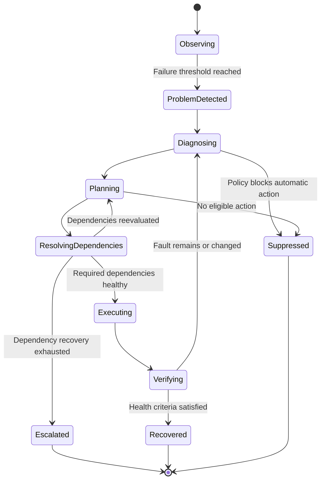

# 6. Recovery Engine

## 6.1 Core state machine



In addition, the following must be supported:

- `Waiting`
- `Cancelled`
- `Interrupted`
- `OutcomeUnknown`

The actual implementation may use a database state enum, but legal state transitions must be defined; state must not be modified arbitrarily in business code.

## 6.2 RecoveryRun

Every failure-handling episode creates an independent RecoveryRun.

Suggested fields:

```text
RecoveryRun
├── id
├── resource_id
├── incident_id
├── status
├── trigger
├── diagnosis
├── dependency_results[]
├── selected_actions[]
├── action_attempts[]
├── verification_results[]
├── started_at
├── updated_at
├── finished_at
├── total_duration
├── outcome
└── error_summary
```

Multiple recovery attempts for the same fault may belong to the same Incident, but every recovery cycle should have its own RecoveryRun for easier auditing and statistics.

## 6.3 Ordered recovery plans

Each resource may define multiple candidate plans.

For a proxy, for example:

1. Check the current node.
2. Switch to a backup node.
3. Restart the proxy service.
4. Re-establish the network connection.
5. Stop automatic handling and notify the user.

Every candidate plan must include:

- A unique ID.
- Applicable failure types.
- Preconditions.
- Risk level.
- Required permissions.
- Execution timeout.
- Maximum attempt count.
- Cooldown.
- Idempotency declaration.
- Verification criteria.
- Failure handling.
- An optional compensation action.

The Core Engine selects applicable plans based on the diagnosis result; it does not unconditionally execute every item in the list.

## 6.4 Re-diagnosis after recovery

This is a key semantic of Custos.

For example:

```text
Proxy node switch
    ↓
Re-check the proxy
    ↓
Proxy healthy
    ↓
Re-check the Cloudflare Tunnel
    ↓
Tunnel still abnormal
    ↓
Diagnose the Tunnel itself
    ↓
Restart cloudflared
    ↓
Verify the Tunnel and the business entry point
```

Do not assume the root cause is still the same after the first action fails.

After every recovery action completes:

1. Save the action result.
2. Re-probe the affected resources.
3. Re-evaluate dependencies.
4. Determine whether the original fault still exists.
5. If the fault changed, diagnose again.
6. Select the next applicable plan.
7. Once the budget limit is reached, terminate and alert.

## 6.5 Recovery budget

All of the following must be limited:

- Per-action timeout.
- Recovery count per resource.
- Total duration of a single RecoveryRun.
- Total recovery budget for the same Incident.
- Restart count per unit of time.
- Concurrent recovery count for the same resource.
- Number of high-risk actions.

When any mandatory limit is reached, the task must terminate or enter a state requiring human intervention.

There must be no recovery loop without an explicit termination condition.

## 6.6 Action execution results

Action execution results must not be limited to success and failure.

At least distinguish:

```text
Succeeded
Failed
TimedOut
Cancelled
OutcomeUnknown
```

For example, if the Custos process suddenly crashes while restarting a service, there is no way to confirm whether the command actually executed. When the recovery task resumes after restart, the same action must not simply be executed again.

The current resource state and the action's observable results must be checked first before deciding to continue, verify, or require human intervention.

---
