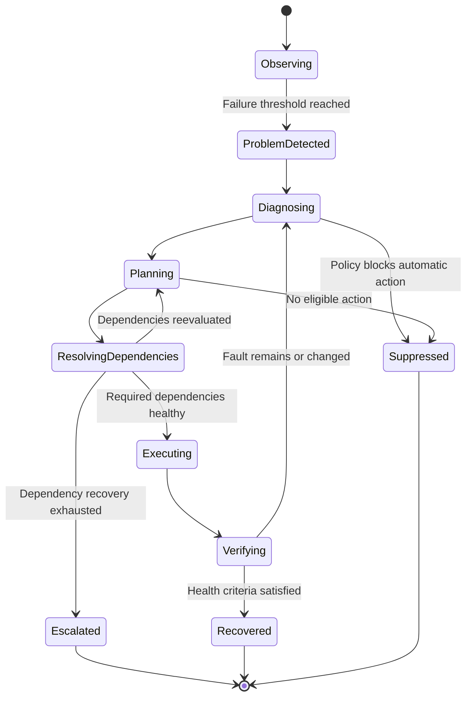

# 6. Recovery Engine

## 6.1 核心状态机



此外还必须支持：

- `Waiting`
- `Cancelled`
- `Interrupted`
- `OutcomeUnknown`

实际实现可以采用数据库状态枚举，但必须定义合法状态转换，不能在业务代码中随意修改状态。

## 6.2 RecoveryRun

每次故障处理创建独立的 RecoveryRun。

建议字段：

```text
RecoveryRun
├── id
├── resource_id
├── incident_id
├── status
├── trigger
├── diagnosis
├── dependency_results[]
├── selected_actions[]
├── action_attempts[]
├── verification_results[]
├── started_at
├── updated_at
├── finished_at
├── total_duration
├── outcome
└── error_summary
```

同一故障的多次恢复尝试可以归属于同一个 Incident，但每个恢复周期应具有独立的 RecoveryRun，方便审计和统计。

## 6.3 有序恢复方案

每个资源可以定义多个候选方案。

例如代理：

1. 检查当前节点。
2. 切换到备用节点。
3. 重启代理服务。
4. 重新建立网络连接。
5. 终止自动处理并通知用户。

每个候选方案必须包含：

- 唯一 ID。
- 适用故障类型。
- 前置条件。
- 风险等级。
- 所需权限。
- 执行超时。
- 最大尝试次数。
- 冷却时间。
- 幂等性声明。
- 验证条件。
- 失败处理。
- 可选补偿动作。

Core Engine 根据诊断结果选择适用方案，而不是无条件执行列表中的每一项。

## 6.4 恢复后重新诊断

这是 Custos 的关键语义。

例如：

```text
代理节点切换
    ↓
重新检查代理
    ↓
代理正常
    ↓
重新检查 Cloudflare Tunnel
    ↓
Tunnel 仍然异常
    ↓
诊断 Tunnel 自身问题
    ↓
重启 cloudflared
    ↓
验证 Tunnel 和业务入口
```

不能在第一个动作失败后直接假设根因仍然相同。

每次恢复动作完成后：

1. 保存动作结果。
2. 重新探测受影响资源。
3. 重新评估依赖关系。
4. 判断原故障是否仍存在。
5. 如果故障发生变化，重新诊断。
6. 选择下一项适用方案。
7. 达到预算上限后终止并告警。

## 6.5 恢复预算

必须同时限制：

- 单动作超时。
- 单个资源的恢复次数。
- 单个 RecoveryRun 的总耗时。
- 同一 Incident 的恢复总预算。
- 单位时间内的重启次数。
- 同一资源的并发恢复数量。
- 高风险动作次数。

达到任意强制限制时，任务必须终止或进入人工介入状态。

不得存在没有明确终止条件的恢复循环。

## 6.6 动作执行结果

动作执行结果不能只有成功和失败。

至少区分：

```text
Succeeded
Failed
TimedOut
Cancelled
OutcomeUnknown
```

例如，重启服务时 Custos 进程突然崩溃，无法确认命令是否已经执行。重启后恢复任务时，不能直接再次执行同一动作。

必须先检查当前资源状态和动作可观察结果，再决定继续、验证还是要求人工介入。

---
